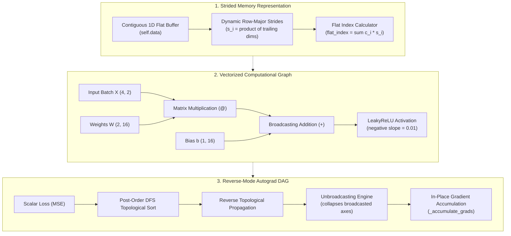

# 🧠 Pure-Python Tensor Engine & Reverse-Mode Autograd

[](https://www.python.org/downloads/)
[](https://en.wikipedia.org/wiki/Automatic_differentiation)
[](requirements.txt)
[](tests/test_engine.py)
[](LICENSE)

A lightweight, educational, and mathematically rigorous **Multidimensional Tensor Library and Reverse-Mode Automatic Differentiation (Autograd) Engine** implemented purely from first principles in standard Python (zero external dependencies like NumPy or PyTorch).

Unlike scalar autograd engines (which process individual neurons one by one in scalar loops), this engine implements **tensor-level parallel execution** using flat contiguous memory buffers, dynamic row-major strides, NumPy-style broadcasting and unbroadcasting, exact matrix calculus, and a PyTorch-style modular neural network API.

---

## 🏛️ System Architecture

The engine bridges low-level memory representation with high-level deep learning abstractions through three decoupled layers:



### Why this design?
* **Contiguous 1D Memory:** All multi-dimensional data is stored in a single flat Python list (`self.data`), mirroring real C/CUDA linear allocations and avoiding the pointer overhead of nested lists.
* **Row-Major Striding:** Coordinates $(c_0, c_1, \dots, c_{n-1})$ are converted to flat indices via stride dot products ($\sum c_i \cdot s_i$), enabling arbitrary N-dimensional indexing and zero-copy transpositions.
* **Broadcasting & Unbroadcasting Symmetry:** Shapes are automatically expanded forward using modulo coordinate arithmetic, and incoming gradients are summed backward across all expanded dimensions to preserve exact mathematical conservation of energy.
* **Topological Reversibility:** Graph execution tracks parent dependencies in a directed acyclic graph (DAG), running backward closures in reverse topological order with re-entrant gradient accumulation.

---

## 🚀 Key Features

* **Zero External Dependencies:** Built entirely with Python's standard library. No NumPy, PyTorch, or external C-extensions required.
* **Strided Memory & Indexing:** Multi-dimensional coordinate generator (`_ndindex`) and dynamic stride calculator (`calculate_strides`).
* **NumPy-Style Broadcasting:** Forward expansion and reverse unbroadcasting (`axes_to_sum`, `unbroadcast`) for arbitrary dimensions.
* **Exact Matrix Calculus:** Fully implemented matrix multiplication (`@`) with analytical transposed gradient propagation:
  $$\frac{\partial \mathcal{L}}{\partial A} = \left(\frac{\partial \mathcal{L}}{\partial C}\right) @ B^T, \quad \frac{\partial \mathcal{L}}{\partial B} = A^T @ \left(\frac{\partial \mathcal{L}}{\partial C}\right)$$
* **Non-Linear Activations:** LeakyReLU activation with piecewise derivative backward pass to prevent dying neurons.
* **Modular Neural Network Abstractions:** PyTorch-style `Module`, `Linear`, `MLP`, and `SGD` optimizer with generator-based parameter discovery (`yield from`) and Xavier/Glorot uniform weight initialization.
* **Finite-Difference Verification:** Unit-tested against numerical finite-difference gradient approximations.

---

## 📊 Benchmark: Solving Non-Linear XOR

The XOR logic gate is the canonical benchmark for neural networks: because XOR is non-linearly separable, a single linear layer mathematically cannot solve it. 

Training an `MLP(in_features=2, hidden_dims=[16, 16], out_features=1)` with our pure-Python engine drives Mean Squared Error (MSE) loss to **0.000000**:

| Epoch | MSE Loss | Status |
| :---: | :---: | :---: |
| **0** | `0.527425` | Initialized |
| **100** | `0.000251` | Converging |
| **200** | `0.000000` | Converged |
| **300** | `0.000000` | Zero Loss |
| **400** | `0.000000` | Zero Loss |
| **500** | `0.000000` | Exact Minimum |

### Final Verification Predictions:
| Sample Input | Target | Model Prediction | Accuracy |
| :---: | :---: | :---: | :---: |
| `[0.0, 0.0]` | `0.0` | `0.0000` | **100%** |
| `[0.0, 1.0]` | `1.0` | `1.0000` | **100%** |
| `[1.0, 0.0]` | `1.0` | `1.0000` | **100%** |
| `[1.0, 1.0]` | `0.0` | `0.0000` | **100%** |

---

## 🛠️ Installation & Quickstart

### 1. Clone the repository
```bash
git clone https://github.com/johnseife2602-source/tensor-engine-autograd.git
cd tensor-engine-autograd
```

### 2. Create and activate a virtual environment
```bash
# Windows (PowerShell)
python -m venv venv
.\venv\Scripts\Activate.ps1

# Linux / macOS
python3 -m venv venv
source venv/bin/activate
```

### 3. Install optional testing dependencies
```bash
pip install -r requirements.txt
```

### 4. Run the canonical XOR training script
```bash
python main.py
```

### 5. Run the automated test suite
```bash
pytest -v
```

---

## 💻 Code Examples

### Basic Autograd
```python
from tensor_engine import Tensor

x = Tensor([3.0])
w = Tensor([2.0])
b = Tensor([1.0])

# Forward pass: y = w * x + b
y = w * x + b

# Backward pass
y.backwards()

print(f"dy/dx: {x.grad.data[0]}")  # 2.0 (w)
print(f"dy/dw: {w.grad.data[0]}")  # 3.0 (x)
print(f"dy/db: {b.grad.data[0]}")  # 1.0
```

### Matrix Multiplication with Transposed Backpropagation
```python
from tensor_engine import Tensor

A = Tensor([[1.0, 2.0], 
            [3.0, 4.0]]) # Shape (2, 2)

B = Tensor([[5.0, 6.0], 
            [7.0, 8.0]]) # Shape (2, 2)

# Forward pass: C = A @ B
C = A @ B
loss = C.sum()
loss.backwards()

print(f"A.grad: {A.grad.data}")  # [11.0, 15.0, 11.0, 15.0]
print(f"B.grad: {B.grad.data}")  # [4.0, 4.0, 6.0, 6.0]
```

### Modular Neural Network (5-Step Training Loop)
```python
from tensor_engine import Tensor, MLP, SGD

# 1. Model & Optimizer
model = MLP(in_features=2, hidden_dims=[16, 16], out_features=1)
optimizer = SGD(model.parameters(), lr=0.5)

# 2. The Standard 5-Step Loop
pred = model(X)                # Step 1: Forward Pass
diff = pred - y
loss = (diff * diff).mean()     # Step 2: Compute Loss
optimizer.zero_grad()           # Step 3: Zero Gradients
loss.backwards()                # Step 4: Backward Pass (Autograd)
optimizer.step()                # Step 5: Optimizer Step
```

---

## 📁 Project Structure

```text
tensor-engine-autograd/
├── tensor_engine/
│   ├── __init__.py           # Package exports (Tensor, Module, Linear, MLP, SGD)
│   ├── engine.py             # Core Tensor, strided memory, and autograd DAG
│   └── nn.py                 # Neural network layers, MLP, and SGD optimizer
├── tests/
│   └── test_engine.py        # 8 comprehensive unit tests & numerical grad check
├── main.py                   # Canonical XOR benchmark training script
├── requirements.txt          # Minimal requirements (0 dependencies for core)
├── .gitignore                # Clean Python ignore rules
├── LICENSE                   # MIT License
└── README.md                 # Project documentation & architecture guide
```

---

## 🧠 Lessons Learned

1. **Strided Memory Layout:** Storing multidimensional data in flat contiguous buffers eliminates pointer dereferencing and allows arbitrary reshaping and transposing by recalculating strides rather than duplicating memory.
2. **The Mathematics of Unbroadcasting:** When a tensor of shape `(1, N)` broadcasts forward to `(B, N)`, it reuses values $B$ times. By the multivariable chain rule, backpropagation requires summing incoming gradients along the broadcasted axis to preserve mathematical gradient conservation.
3. **Weight Initialization Dynamics:** Unscaled random weights (`[-1, 1]`) cause activation variance to explode exponentially with depth ($\Variance(y) ~ Nin * Variance(x)$). Implementing Xavier/Glorot uniform initialization ($\sqrt{6 / (in + out)}$) guarantees stable variance across forward and backward passes.
4. **Generator-Based Parameter Traversal:** Implementing `parameters()` as a recursive generator with `yield from` provides lazy, memory-efficient parameter discovery across nested submodules without manually maintaining parameter registries.

---

## 📄 License

This project is licensed under the [MIT License](LICENSE).

---

## 👤 Author

**Yohans Seife**

- GitHub: [@johnseife2602-source](https://github.com/johnseife2602-source)

Project 4 of my learning roadmap toward AI engineering. Project 3:
[concurrent-web-scraper](https://github.com/johnseife2602-source/concurrent-web-scraper).
